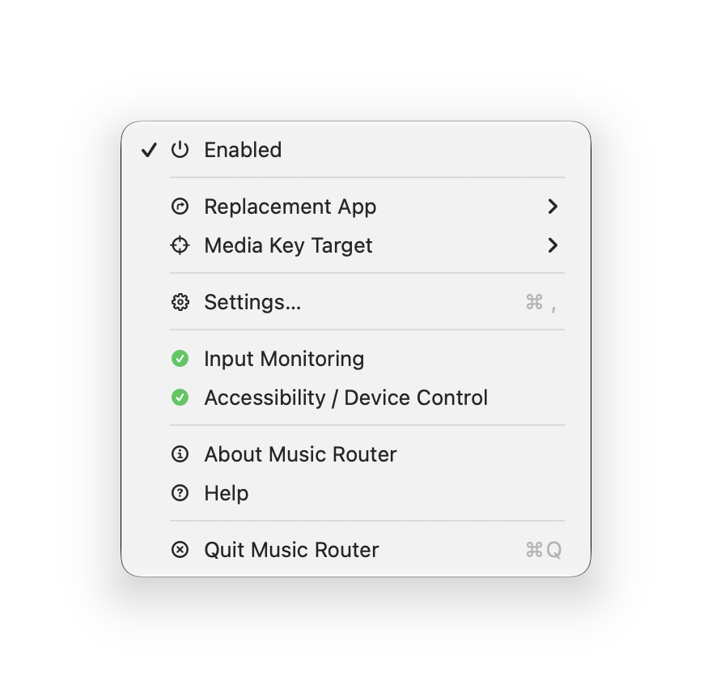
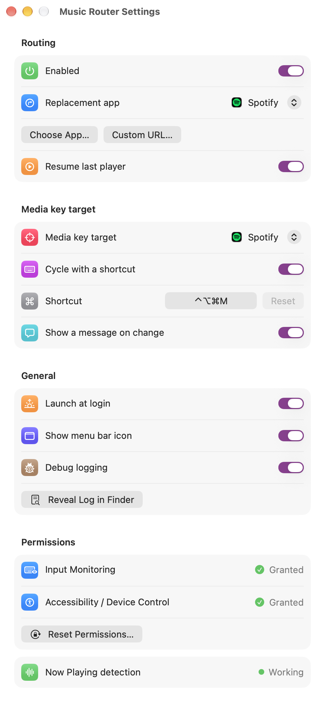

# Music Router

A menu-bar utility that stops Music.app/iTunes from launching when you don't
want it to, and routes your keyboard's media keys to whichever app should
actually get them.

[More Drumandbytes projects](https://drumandbytes.com/projects/?ref=music-router-readme)

<p align="center">
<picture>
  <source media="(prefers-color-scheme: dark)" srcset="docs/img/menu-dark.png">
  
</picture>
</p>

Built as a more functional, actively-maintained replacement for
[noTunes](https://github.com/tombonez/noTunes). It keeps noTunes' core idea:
watch for Music.app/iTunes launching and quit it immediately. That's the right
approach because it's the one that works without weakening the system. Music.app
lives on macOS's sealed, SIP-protected system volume, so it can't be removed,
renamed or locked down, and there is no public API to veto another app's launch.
Reacting to the launch, however it was triggered (a media key, AirPlay, Handoff,
Siri), covers every path. Music Router adds a lower-level fix for the keyboard
case, so a media key never launches Music in the first place, and real playback
control of the replacement app, not just launching it. See
[How it works](docs/how-it-works.md#two-blocking-mechanisms).

I wrote it because noTunes hadn't been updated for about 15 months (last commit
August 2024, as of November 2026) and I wanted it to keep working on current
macOS, with the media keys behaving too. I use Music Router myself every day.

## What it does

- **Blocks Music.app/iTunes** from launching: media keys are intercepted
  before macOS can launch it (no flash), and anything else that launches it
  (AirPlay, Handoff, Siri) is terminated immediately.
- **Leaves alone what's already playing.** If any app or browser tab owns
  Now Playing, the key goes straight through to it, exactly as without this
  app.
- **Starts something useful when nothing is playing**: the last app that
  played (if still running and scriptable), otherwise your replacement app
  (Spotify, TIDAL, VLC, a web player, any app), actually playing, not just
  opened.
- **Pin a media-key target** among several players (Spotify, VLC) from the
  menu or with a remappable global shortcut (⌃⌥⌘M by default).
- **Keeps working when Now Playing detection breaks**: it falls back to a
  CoreAudio check, restarts the adapter and shows the state in Settings.
- **No extra install for Now Playing**: the MediaRemote adapter is bundled,
  and a small `musicrouter-media` command-line tool exposes it to scripts.
- Menu bar icon (hideable), Settings window, launch at login, permission
  reset and opt-in debug logging.

## Install

```bash
brew install drumandbytes/tap/music-router
```

No other dependencies: the MediaRemote adapter is bundled (earlier versions
needed `brew install media-control`, which you can remove if nothing else uses
it), and the cask also links the `musicrouter-media` command-line tool onto your
`PATH`.

It's ad-hoc signed (no Apple Developer Program enrollment, unnecessary for a
personally-distributed tool), so macOS shows the normal one-time "unidentified
developer" prompt on first launch: approve it in System Settings → Privacy &
Security → Open Anyway.

First launch asks for **Input Monitoring** and **Accessibility** (called
**Device Control and Data Access** on macOS 27). Both are needed to intercept
the media keys. The prompt only shows once; the menu and Settings show each
grant and its status afterwards.

## Use

Click the note icon: **Enabled**, **Replacement App** (a shortlist, any local
app, a web player, or block only), **Media Key Target**, **Settings…** (⌘,),
the two permission rows, **About** and **Help**. Everything else (resume last
player, the shortcut, launch at login, logging) is in Settings.

<p align="center">
<picture>
  <source media="(prefers-color-scheme: dark)" srcset="docs/img/settings-dark.png">
  
</picture>
</p>

With the optional shortcut on, ⌃⌥⌘M cycles which player gets the media keys and
shows a short message:

<p align="center">
<picture>
  <source media="(prefers-color-scheme: dark)" srcset="docs/img/toast-dark-spotify.png">
  
</picture>
&nbsp;&nbsp;
<picture>
  <source media="(prefers-color-scheme: dark)" srcset="docs/img/toast-dark-automatic.png">
  
</picture>
</p>

## Documentation

- **[Help](docs/help.md)**: keys do nothing, wrong app gets the key, detection
  status, the shortcut, reporting a bug, removal.
- **[Configuration](docs/configuration.md)**: the menu and Settings in full, every
  `defaults` key, the `musicrouter-media` command line.
- **[How it works](docs/how-it-works.md)**: the two blocking mechanisms, how keys
  are routed, the Now Playing adapter, the fallback, and the known limits.
- **[Development](docs/development.md)**: building, testing, signing, third-party
  code and how the project is maintained and released.

## Compared with similar tools

- **[noTunes](https://github.com/tombonez/noTunes)** is the original, and
  Music Router reuses its Music-blocking approach. Its README describes
  blocking Music/iTunes and a menu bar toggle. Music Router adds the media-key
  interception (no launch-then-quit flash for key presses), a check for what is
  already playing (with a fallback when that check fails), a replacement app it
  can actually start playing, resuming the last player, pinning one of several
  players as the key target, launch at login and a settings window. noTunes is
  simpler and needs no permissions beyond launching; Music Router needs Input
  Monitoring and Accessibility for the key tap.
- **[BeardedSpice](https://github.com/beardedspice/beardedspice)** does a
  different job: it lets the media keys control web players in Chrome or Safari
  tabs. It doesn't stop Music from launching, and its last release was in 2017.
  Music Router doesn't control browser tabs itself; it lets macOS route the
  keys to whichever tab owns Now Playing.

## Limits

Music launched by AirPlay, Handoff or Siri is closed right after it starts, not
prevented. Targeting and resume work for scriptable native apps only. Now
Playing detection uses a private framework and can break on a macOS update (a
fallback keeps blocking and routing working). It's ad-hoc signed. Details in
[How it works](docs/how-it-works.md#known-limits).

## How it was made

Built with the help of an AI coding assistant (Claude). I review and test what gets published.

## License

MIT
