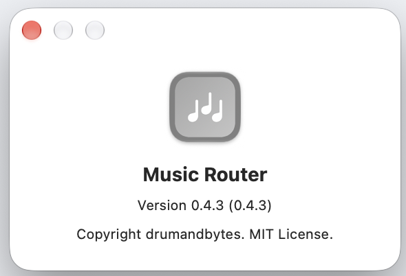
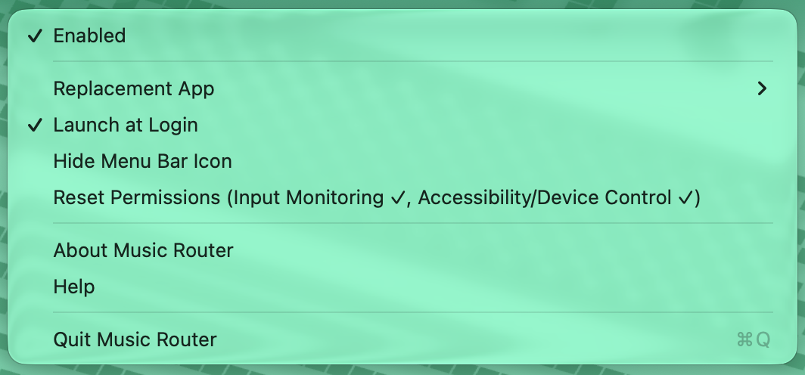

# Music Router

A menu-bar utility that stops Music.app/iTunes from launching when you don't
want it to, and routes your keyboard's media keys to whichever app should
actually get them.

[More Drumandbytes projects](https://drumandbytes.com/projects/?ref=music-router-readme)



Built as a more functional, actively-maintained replacement for
[noTunes](https://github.com/tombonez/noTunes), whose Music-blocking approach
this reuses (it's the correct one), extended with a lower-level fix for the
keyboard case and real playback control of the replacement app, not just
launching it.

I wrote it because noTunes hadn't been updated for about 15 months (last commit
August 2024, as of November 2026) and I wanted it to keep working on current
macOS, with the media keys behaving too. I use Music Router myself every day.

## What it does

- **Blocks Music.app/iTunes** from launching: media keys are intercepted
  before macOS can launch it (no flash), and anything else that launches it
  (AirPlay, Handoff, Siri) is terminated immediately.
- **Leaves alone what's already playing.** If any app or browser tab owns
  Now Playing, the key goes straight through to it, exactly as without this
  app.
- **Starts something useful when nothing is playing**: the last app that
  played (if still running and scriptable), otherwise your replacement app
  (Spotify, TIDAL, VLC, a web player, any app), actually playing, not just
  opened.
- **Pin a media-key target** among several players (Spotify, VLC, Vox,
  Swinsian) from the menu or with a remappable global shortcut (⌃⌥⌘M by
  default).
- **Keeps working when Now Playing detection breaks**: it falls back to a
  CoreAudio check, restarts the adapter and shows the state in Settings.
- **No extra install for Now Playing**: the MediaRemote adapter is bundled,
  and a small `musicrouter-media` command-line tool exposes it to scripts.
- Menu bar icon (hideable), Settings window, launch at login, permission
  reset and opt-in debug logging.

## Compared with similar tools

- **[noTunes](https://github.com/tombonez/noTunes)** is the original, and
  Music Router reuses its Music-blocking approach. Its README describes
  blocking Music/iTunes and a menu bar toggle. Music Router adds the media-key
  interception (no launch-then-quit flash for key presses), a check for what is
  already playing (with a fallback when that check fails), a replacement app it
  can actually start playing, resuming the last player, pinning one of several
  players as the key target, launch at login and a settings window. noTunes is
  simpler and needs no permissions beyond launching; Music Router needs Input
  Monitoring and Accessibility for the key tap.
- **[BeardedSpice](https://github.com/beardedspice/beardedspice)** does a
  different job: it lets the media keys control web players in Chrome or Safari
  tabs. It doesn't stop Music from launching, and its last release was in 2017.
  Music Router doesn't control browser tabs itself; it lets macOS route the
  keys to whichever tab owns Now Playing.

## How it works

Two independent mechanisms, because Music.app can be launched through paths
that need different fixes:

- **`MediaKeyTap`** — intercepts play/pause/next/previous at the HID/session
  level with a `CGEventTap` (the technique Spotify open-sourced years ago as
  `SPMediaKeyTap`), before macOS's default handler can decide "nothing's
  listening" and launch Music. The event is consumed, so Music never launches
  for this trigger — no flash, no launch-then-kill.
- **`MusicLauncherGuard`** — for everything else (AirPlay speaker selection,
  Handoff from iPhone, Siri "play some music"), which don't route through a
  key event and have no public veto hook. This watches
  `NSWorkspace.didLaunchApplicationNotification` and force-terminates
  Music/iTunes immediately if it launches, same approach noTunes uses. This is
  a real, permanent limitation — not a bug to eventually fix.

## Routing the keys

A media key press first checks whether something is *already* the system's
Now Playing session — native app or a browser tab, anything using the Media
Session/MediaRemote machinery — via `NowPlayingObserver`. If so, the key is
let through untouched, so macOS's own native routing reaches it directly,
exactly as if this app didn't exist; no app-specific code needed on our side.
Only when *nothing* is currently playing does `MediaKeyTap` swallow the key
and launch the configured replacement — for a native app with an AppleScript
dictionary (Spotify, VLC, Music all share iTunes' old
`playpause`/`next track`/`previous track` verbs), `AppleScriptRemote` forces
it into a playing state rather than just opening a window; web replacements
and non-scriptable native apps (e.g. TIDAL) fall back to a plain open.

`NowPlayingObserver` reads Now Playing through the private `MediaRemote`
framework, which since macOS 15.4 only answers Apple-signed processes. It
uses the [`mediaremote-adapter`](https://github.com/ungive/mediaremote-adapter)
technique: `/usr/bin/perl` (signed `com.apple.perl5`) runs the adapter's
script, which loads a small bundled framework and calls MediaRemote from
inside that entitled process. A pinned copy (v0.7.7, BSD-3) is vendored under
`third_party/mediaremote-adapter/`, built into the app by `scripts/build-app.sh`,
and bundled in the app (`Contents/Frameworks`, `Contents/Resources`), so
there's no separate install. It runs once as a long-lived background process
(`perl mediaremote-adapter.pl … stream`) at launch, caching the latest state
in memory, so a media key press only reads an already-current flag — no
subprocess spawned on the key-press path.

### Choosing the target app

By default Now Playing decides who gets the keys. With several players
running you can pin one: **Media Key Target** in the menu (or Settings) picks
Spotify, VLC, Vox or Swinsian (whichever are installed). While one is picked,
Music Router swallows play/next/previous and sends them to that app through
AppleScript, whatever owns Now Playing, launching it first if it isn't
running. The optional global shortcut (off by default, a checkbox in the same
submenu or in Settings) cycles Automatic → each running player → Automatic and
shows a brief on-screen message with the new target (switch it off with **Show
Message on Change** or in Settings) and flashes it next to the menu bar icon. It defaults to **⌃⌥⌘M**; in
Settings, click the shortcut button and press a new combination to remap it
(it needs ⌘, ⌥ or ⌃; Esc cancels, **Reset** restores the default). If another
app already owns the combination, Settings says so. It uses a plain global
hotkey, so it needs no extra permission.

Limits: MediaRemote only reports and controls one Now Playing app, so this
works for scriptable native apps only, which is why the list is a short
allowlist. TIDAL has no AppleScript dictionary: it appears as "launch only"
and, if picked, is just opened (instead of the replacement) when nothing is
playing. Browser tabs can't be targeted. The first key sent to an app
triggers macOS's Automation prompt for it.

### Resuming the last player

The adapter's stream also says *which* app is playing. Music Router remembers
the last bundle ID that was actively playing. When nothing owns Now Playing
and you press a media key, it sends the key (AppleScript `playpause` / `next
track` / `previous track`) to that app if it is still running and
scriptable, instead of launching the fixed replacement. Otherwise (the app
quit, isn't scriptable, or nothing has played since launch) it falls back to
the replacement as before. On by default; **Resume Last Player** in the menu
and Settings turns it off (`defaults write dev.drumandbytes.musicrouter
resumeLastPlayer -bool false`).

Limits: the memory is per launch, not saved. A paused player usually keeps
Now Playing (the key reaches it through macOS), so this mostly applies after
an app stops or drops its session. Browser tabs report the browser or a
WebKit/Chromium helper process, which doesn't understand those AppleScript
verbs, so they fall back to the replacement. The first send to an app
triggers macOS's Automation permission prompt for it. Music/iTunes is never
a target.

### Command line

The app bundles a small CLI over the same adapter, so scripts (a status bar,
Hammerspoon) can read and control Now Playing without a separate
`media-control` install:

```bash
musicrouter-media stream   # JSON per change
musicrouter-media get      # JSON, or null
musicrouter-media toggle   # also play|pause|stop|next|previous
```

(Installed with Homebrew it's on your `PATH`; otherwise it lives at
`MusicRouter.app/Contents/Resources/musicrouter-media`.)

`stream` and `get` print the adapter's JSON (`payload` with `title`, `artist`,
`playing`, `bundleIdentifier`, …, artwork omitted). It runs its own adapter
process, independent of the app's, so it works whether or not the app is
running, as long as the bundle is installed. It follows symlinks. It reads and controls the system's
single Now Playing app, like the media keys do.

### When detection fails

If the adapter can't start or stops answering (a macOS update broke
MediaRemote access, `/usr/bin/perl` is missing, the build lacks the bundled
framework), the app keeps working: Music is still blocked and media keys are
still routed. It falls back to a public CoreAudio check — "is any process
driving the default output device?" — in place of Now Playing. That's coarser:
a paused player isn't detected (the key then goes to the replacement), and
unrelated audio such as a call counts as "playing" (the key passes through
to macOS). The adapter is relaunched with backoff and takes over again as
soon as it reports data. A stalled adapter is caught too: the stream only
prints on change, so if it claims nothing is playing while audio keeps running
for ~15 s, the app asks the adapter once (`get`); if that names a player, the
stream is restarted and the fallback is used meanwhile. **Settings → Now Playing detection** shows
Working / Starting / Unavailable with the reason. A noTunes-style app with no
Now Playing check at all has no equivalent.

## Building

No Xcode required — just the Xcode Command Line Tools (`xcode-select --install`),
which provide `swift` and `clang` (the vendored adapter framework is compiled
with `clang` by `scripts/build-adapter.sh`, no CMake):

```bash
scripts/build-app.sh [version]   # swift build + bundle assembly + ad-hoc codesign
open build/MusicRouter.app
```

First launch prompts for **Input Monitoring** and **Accessibility**
permission (System Settings → Privacy & Security — renamed to **Device
Control and Data Access** in macOS 27; same underlying permission, same
`AXIsProcessTrustedWithOptions` API, just a new label) — both are needed for
the media key tap; `CGEventTapCreate` silently fails with only one granted. The
prompt only shows once ever, even across relaunches while you haven't
granted it yet — check Settings at your own pace rather than getting
re-alerted every launch.

## Installing

```bash
brew install drumandbytes/tap/music-router
```

No other dependencies: the MediaRemote adapter is bundled (earlier versions
needed `brew install media-control`, which you can remove if nothing else
uses it), and the cask also links the `musicrouter-media` command-line tool
onto your `PATH` (see "Command line").

Since it's ad-hoc signed (no Apple Developer Program enrollment — unnecessary
for a personally-distributed tool), macOS will show the normal one-time
"unidentified developer" prompt on first launch. Approve it once in System
Settings → Privacy & Security → Open Anyway.

## Menu bar



Click the note icon for:

- **Enabled** — toggle both interception mechanisms on/off. Remembered
  across relaunches.
- **Media Key Target** — pin the player that gets the media keys (or
  Automatic), and enable the cycle shortcut (remappable in Settings); see above.
- **Resume Last Player** — with nothing playing, the play key resumes the
  last app that played, if still running and scriptable; see above.
- **Replacement App** — a curated shortlist (Spotify, TIDAL, VLC, YouTube
  Music, Deezer, SoundCloud — native apps only show if actually installed),
  **Choose App…** for any other local app, **Custom URL…** for any other web
  player, or **Block Only** for no redirect.
- **Launch at Login** — via `SMAppService`, no manual System Settings step.
- **Settings…** (⌘,) — a window with the same options, plus permission
  status and the Now Playing detection status. The icon stays hidden across launches; to get back, relaunch the
  app (even while it's already running — double-click it again in Finder) to
  open the settings window and tick **Show menu bar icon**.
- **Hide Menu Bar Icon** — hides the icon; see above for the way back.
- **Debug Logging** / **Reveal Log in Finder** — off by default; see
  "Reporting a bug" below.
- **Reset Permissions** — shows Input Monitoring/Accessibility grant status
  inline, and (after confirming) clears both via `tccutil reset` and
  relaunches the app so you can re-grant them. See "A note on signing" below
  for why a grant can go stale in the first place.

## Settings from the command line

Everything in the menu is a plain `defaults` key in
`dev.drumandbytes.musicrouter`, so it can be scripted (e.g. from dotfiles):

| Key | Type | Meaning |
| --- | --- | --- |
| `replacement` | string | App path or URL opened when nothing plays; delete for block-only |
| `resumeLastPlayer` | bool | Resume the last playing app first (default `true`) |
| `targetApp` | string | Bundle ID pinned as the media-key target; delete for automatic |
| `cycleShortcut` | bool | The shortcut cycles the target (default `false`) |
| `showTargetToast` | bool | On-screen message when the shortcut changes the target (default `true`) |
| `cycleShortcutKeyCode`, `cycleShortcutModifiers`, `cycleShortcutKey` | int, int, string | Custom shortcut (Carbon key code and modifier mask, display label); delete all three for the ⌃⌥⌘M default |
| `enabled` | bool | Interception on/off (default `true`) |
| `debugLogging` | bool | Write `~/Library/Logs/MusicRouter.log` |

## Help

**Help** in the menu opens [docs/help.md](docs/help.md): permissions, a key
going to the wrong app, detection status, the shortcut, scripting and removal.

## Reporting a bug

Turn on **Debug Logging** in the menu (or `defaults write
dev.drumandbytes.musicrouter debugLogging -bool true`), reproduce the
problem, then use **Reveal Log in Finder** and attach
`~/Library/Logs/MusicRouter.log` to your issue.

The log records only: which of the three media keys was pressed (play/pause,
next, previous) and whether it was swallowed or passed through, the bundle ID
of whichever app owns Now Playing and when that changes, and
adapter/event-tap start and stop. Never other keys, track titles,
artists, or window contents. It rotates at 2 MB, keeping one older file
(`MusicRouter.log.1`), and costs nothing while off.

## Testing

```bash
swift test
```

Covers the pure and process-level pieces: `MediaKeyTap.decode`'s media-key
bit-unpacking, `Config`'s persistence and defaults, `MusicLauncherGuard`'s
bundle-ID matching, `DebugLog`'s gating and rotation, and `NowPlayingObserver`
against a fake adapter process (healthy, silent, exiting, missing, stalled,
recovering), plus target cycling, last-player selection and the
`musicrouter-media` command mapping. CI prints a coverage summary (no external
service); the untestable AppKit/event-tap code keeps the total low by design.
Not attempting to test the `CGEventTap`/TCC machinery or the real MediaRemote
adapter itself: that needs a real signed app, a real permission grant and a
real key press or playing app, none of which are practical in CI (see "A note
on signing" below for how flaky that combination already is even by hand).

## A note on signing

This app is ad-hoc signed, not notarized — a paid Apple Developer Program
membership ($99/year) is the only way to remove that entirely, and isn't
worth it yet for a personally-distributed tool. Since it's never downloaded
through a browser, no quarantine attribute gets attached; Homebrew casks
installing it go through the normal one-time Gatekeeper approval like any
non-Developer-ID-signed app.

If you build it yourself and re-sign with a different identity, note that
`CGEventTap` permissions (Input Monitoring **and** Accessibility, aka
**Device Control and Data Access** on macOS 27 — both required) are tied to
code-signing identity — either can silently stop
working after a re-sign with no error, independently of each other.
`MediaKeyTap` checks every 5 seconds and reinstalls itself if the tap is dead
or never managed to install, which covers the common case, but the
underlying grant may still need re-approving in System Settings after a
signing-identity change. If toggling it in Settings doesn't seem to take
effect, the menu's **Reset Permissions** action (or manually,
`tccutil reset ListenEvent dev.drumandbytes.musicrouter` and/or
`Accessibility` in place of `ListenEvent`) forces a clean re-registration —
System Settings can show a stale "enabled" toggle for a grant that's no
longer actually bound to the current build.

When moving to Developer ID signing + notarization: notarization requires
hardened runtime (`codesign --options runtime`), and under it AppleEvents to
other apps are denied unless the `com.apple.security.automation.apple-events`
entitlement is present — `scripts/build-app.sh` already applies
`Resources/MusicRouter.entitlements`, so only the identity and `--options
runtime` need adding.

## Third-party code

`third_party/mediaremote-adapter/` is an unmodified copy of
[ungive/mediaremote-adapter](https://github.com/ungive/mediaremote-adapter)
v0.7.7 (BSD 3-Clause, © 2025 Jonas van den Berg and contributors; license in
`third_party/mediaremote-adapter/LICENSE`, also shipped inside the app).
Only the test client source is omitted. A weekly workflow
(`.github/workflows/adapter-update.yml`) checks upstream for a newer release
and opens a **draft** PR that runs `scripts/update-adapter.sh <tag>`; it stays
a draft until the adapter has been tried on a Mac, because CI only proves it
compiles. To update by hand, run `scripts/update-adapter.sh <tag>` yourself.

## Known limits

- **Music launched by AirPlay, Handoff or Siri is killed after it starts**,
  not prevented; there's no public hook to veto those launches.
- **MediaRemote reports and controls one Now Playing app.** Targeting and
  last-player resume work for scriptable native apps only; browser tabs get
  the keys through macOS when they own Now Playing, but can't be targeted.
- **Now Playing detection uses a private framework** through the adapter
  technique and can break on a macOS update; the CoreAudio fallback then
  applies (see "When detection fails").
- **Ad-hoc signed**, so the one-time Gatekeeper prompt and signing-bound
  permissions apply (see "A note on signing").

## How it was made

Built with the help of an AI coding assistant (Claude). I review and test what gets published.

## License

MIT
