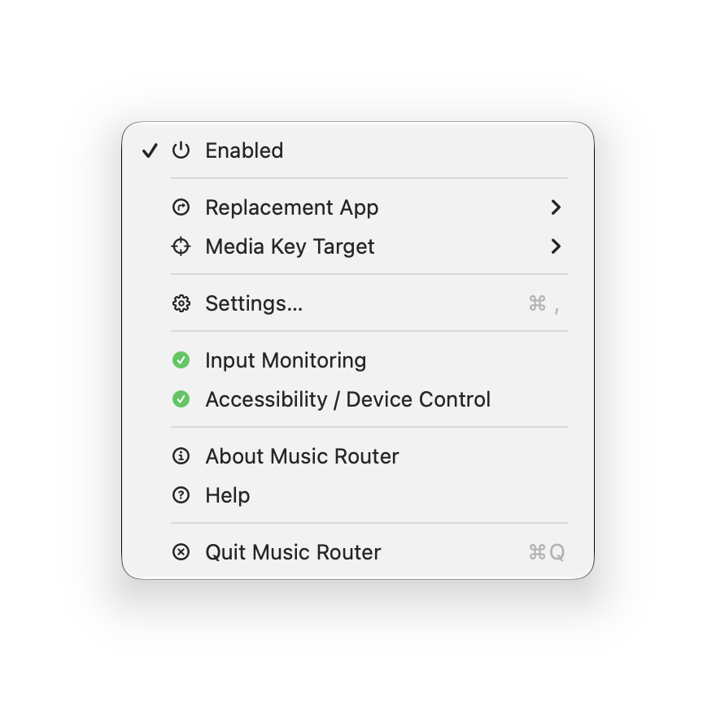
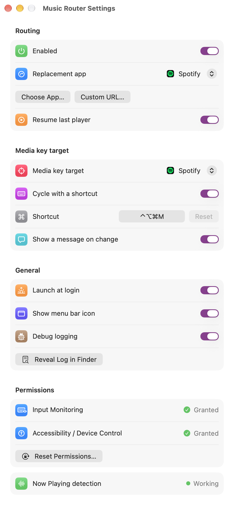
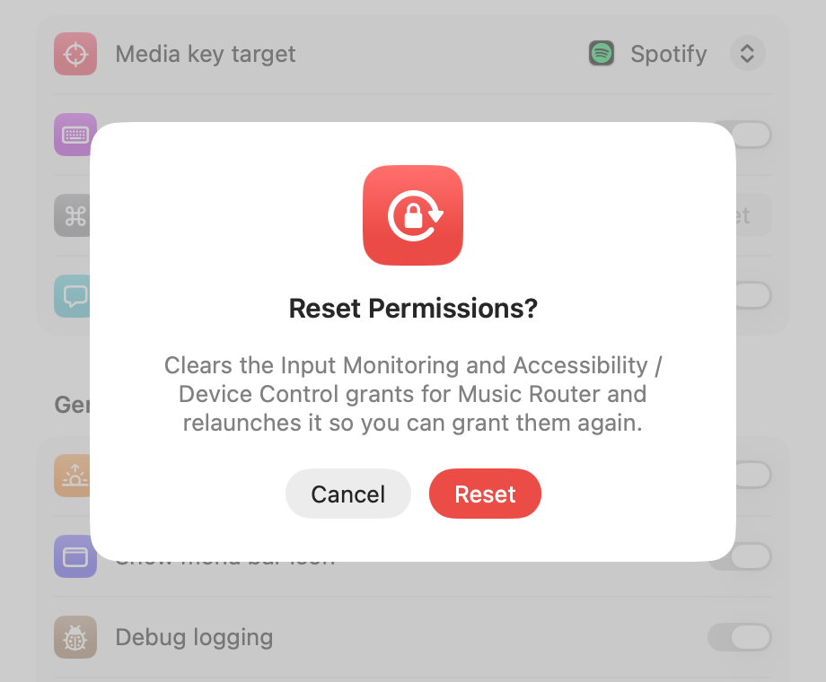
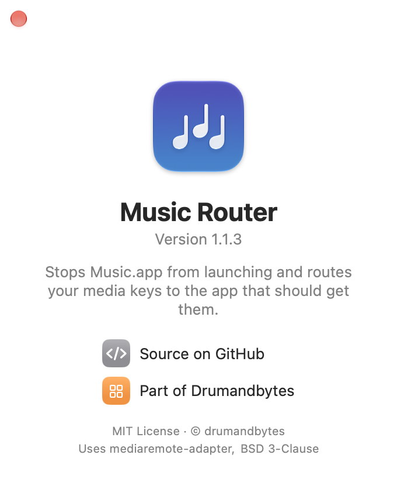

# Configuration

## Menu bar

<p align="center">
<picture>
  <source media="(prefers-color-scheme: dark)" srcset="img/menu-dark.png">
  
</picture>
</p>

Click the note icon for the essentials:

- **Enabled**: toggle both interception mechanisms on/off. Remembered across
  relaunches.
- **Replacement App**: a curated shortlist (Spotify, TIDAL, VLC, YouTube Music,
  Deezer, SoundCloud; native apps only show if actually installed),
  **Choose App…** for any other local app, **Custom URL…** for any other web
  player, or **Block Only** for no redirect.
- **Media Key Target**: pin the player that gets the media keys, or Automatic
  (see [How it works](how-it-works.md#choosing-the-target-app)).
- **Settings…** (⌘,): everything else.
- **Input Monitoring** / **Accessibility / Device Control**: a green check or
  red cross for each grant; click one to open its pane.
- **About** and **Help**.

## Settings

<p align="center">
<picture>
  <source media="(prefers-color-scheme: dark)" srcset="img/settings-dark.png">
  
</picture>
</p>

Settings (⌘, or **Settings…**) has the same options plus the rest:

- **Routing**: Enabled, the replacement app, **Resume last player**.
- **Media key target**: the target, the cycle shortcut with its recorder and
  **Reset**, and the on-screen message when it changes.
- **General**: **Launch at login** (via `SMAppService`, no manual System Settings
  step), **Show menu bar icon**, **Debug logging**, **Reveal Log in Finder**.
- **Permissions**: the status of each grant and **Reset Permissions…**, which
  clears both via `tccutil reset` and relaunches the app so you can re-grant
  them (see [Development](development.md#signing) for why a grant goes stale).
- **Now Playing detection**: Working, Starting or Unavailable with the reason.

**Reset Permissions…** asks first:

<p align="center">
<picture>
  <source media="(prefers-color-scheme: dark)" srcset="img/dialog-dark.png">
  
</picture>
</p>

The menu bar icon stays hidden across launches. To get back, relaunch the app
(even while it's already running: double-click it again in Finder) to open
Settings and tick **Show menu bar icon**.

## About

**About** shows the version, links to the source and to the other Drumandbytes
projects, and the licence notices:

<p align="center">
<picture>
  <source media="(prefers-color-scheme: dark)" srcset="img/about-dark.png">
  
</picture>
</p>

## `defaults` keys

Everything is a plain `defaults` key in `dev.drumandbytes.musicrouter`, so it can
be scripted (e.g. from dotfiles):

| Key | Type | Meaning |
| --- | --- | --- |
| `replacement` | string | App path or URL opened when nothing plays; delete for block-only |
| `resumeLastPlayer` | bool | Resume the last playing app first (default `true`) |
| `targetApp` | string | Bundle ID pinned as the media-key target; delete for automatic |
| `cycleShortcut` | bool | The shortcut cycles the target (default `false`) |
| `showTargetToast` | bool | On-screen message when the shortcut changes the target (default `true`) |
| `cycleShortcutKeyCode`, `cycleShortcutModifiers`, `cycleShortcutKey` | int, int, string | Custom shortcut (Carbon key code and modifier mask, display label); delete all three for the ⌃⌥⌘M default |
| `enabled` | bool | Interception on/off (default `true`) |
| `debugLogging` | bool | Write `~/Library/Logs/MusicRouter.log` |

For example:

```bash
defaults write dev.drumandbytes.musicrouter replacement /Applications/Spotify.app
defaults delete dev.drumandbytes.musicrouter replacement   # block only
```

## Command line

The app bundles a small CLI over the same adapter, so scripts (a status bar,
Hammerspoon) can read and control Now Playing without a separate
`media-control` install:

```bash
musicrouter-media stream   # JSON per change
musicrouter-media get      # JSON, or null
musicrouter-media toggle   # also play|pause|stop|next|previous
```

Installed with Homebrew it's on your `PATH`; otherwise it lives at
`MusicRouter.app/Contents/Resources/musicrouter-media`.

`stream` and `get` print the adapter's JSON (`payload` with `title`, `artist`,
`playing`, `bundleIdentifier`, …, artwork omitted). It runs its own adapter
process, independent of the app's, so it works whether or not the app is
running, as long as the bundle is installed. It follows symlinks. It reads and
controls the system's single Now Playing app, like the media keys do.
